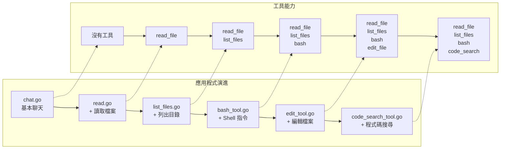
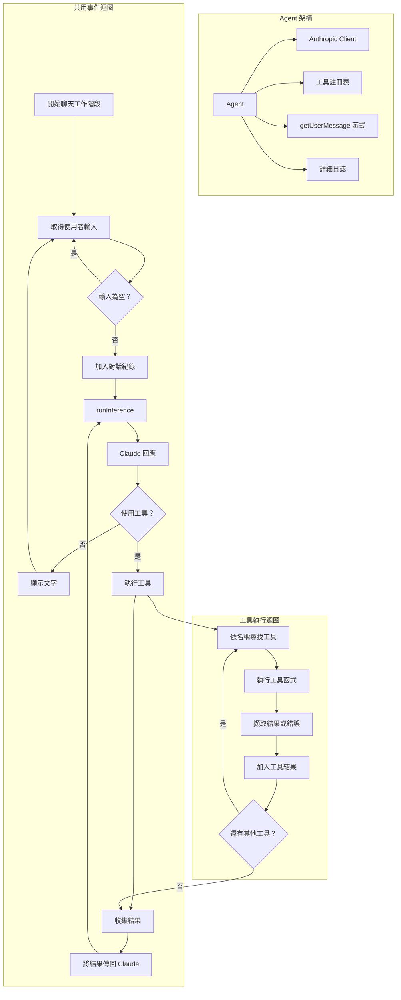

# 🧠 透過循序漸進的工作坊打造自己的 Coding Agent

**語言：** [English](README.md) | [繁體中文（台灣）](README.zh-TW.md)

歡迎！👋 這個工作坊將引導你打造自己的 **AI 程式碼助理**，從基本聊天機器人開始，逐步加入讀取檔案、執行 Shell 指令和搜尋程式碼等強大工具。

你不需要是 AI 專家，只要跟著步驟一步步實作即可！

🌐 **想先了解詳細概念嗎？** 請閱讀這篇部落格文章：[ghuntley.com/agent](https://ghuntley.com/agent/)。

---

## 🎯 你將學到什麼

完成這個工作坊後，你將了解如何：

- ✅ 連接 Anthropic Claude API
- ✅ 建立簡單的 AI 聊天機器人
- ✅ 加入讀取檔案、編輯程式碼和執行指令等工具
- ✅ 處理工具請求和錯誤
- ✅ 逐步打造功能愈來愈強大的 Agent

---

## 🛠️ 我們要打造什麼

你將建立 6 個版本的程式碼助理。

每個版本都會增加更多功能：

1. **基本聊天** — 與 Claude 對話
2. **檔案讀取器** — 讀取程式碼檔案
3. **檔案總管** — 列出資料夾中的檔案
4. **指令執行器** — 執行 Shell 指令
5. **檔案編輯器** — 修改檔案
6. **程式碼搜尋** — 使用模式搜尋程式碼庫



最後，你將擁有一個功能強大的本機開發助理！

---

## 🧱 運作方式（架構）

每個 Agent 的運作方式如下：

1. 等待你的輸入
2. 將輸入傳送給 Claude
3. Claude 可能直接回覆，也可能要求使用工具
4. Agent 執行工具（例如讀取檔案）
5. 將結果傳回 Claude
6. Claude 提供最終回答

我們將這稱為**事件迴圈（event loop）**，就像 Agent 的心跳一樣。



## 🚀 開始使用

### ✅ 前置需求

* Go 1.24.2 以上版本，或 [devenv](https://devenv.sh/)（建議使用，方便設定）
* 一組 [Anthropic API Key](https://platform.claude.com/settings/keys)

### 🔧 設定環境

**選項 1：建議方式（使用 devenv）**

```bash
devenv shell  # Loads everything you need
```

**選項 2：手動設定**

```bash
# Make sure Go is installed
go mod tidy
```

### 🔐 加入 API Key

```bash
export ANTHROPIC_API_KEY="your-api-key-here"
```

---

## 🏁 從基礎開始

### 1. `chat.go` — 基本聊天

一個與 Claude 對話的簡單聊天機器人。

```bash
go run chat.go
```

* ➡️ 試試：「你好！」
* ➡️ 加上 `--verbose` 查看詳細日誌

---

## 🛠️ 加入工具（一次一步）

### 2. `read.go` — 讀取檔案

現在 Claude 可以讀取你電腦上的檔案。

```bash
go run read.go
```

* ➡️ 試試：「讀取 fizzbuzz.js」

---

### 3. `list_files.go` — 探索資料夾

讓 Claude 瀏覽你的目錄。

```bash
go run list_files.go
```

* ➡️ 試試：「列出這個資料夾中的所有檔案」
* ➡️ 試試：「fizzbuzz.js 裡面有什麼？」

---

### 4. `bash_tool.go` — 執行 Shell 指令

讓 Claude 執行安全的終端機指令。

```bash
go run bash_tool.go
```

* ➡️ 試試：「執行 git status」
* ➡️ 試試：「使用 bash 列出所有 .go 檔案」

---

### 5. `edit_tool.go` — 編輯檔案

現在 Claude 可以**修改程式碼**、建立檔案並進行變更。

```bash
go run edit_tool.go
```

* ➡️ 試試：「建立一個 Python Hello World 腳本」
* ➡️ 試試：「在 fizzbuzz.js 頂端加入註解」

---

### 6. `code_search_tool.go` — 搜尋程式碼

使用模式搜尋（由 [ripgrep](https://github.com/BurntSushi/ripgrep) 提供支援）。

```bash
go run code_search_tool.go
```

* ➡️ 試試：「找出 Go 檔案中的所有函式定義」
* ➡️ 試試：「搜尋 TODO 註解」

---

## 🧪 範例檔案（已包含在內）

1. `fizzbuzz.js`：用於檔案讀取與編輯
1. `riddle.txt`：一個有趣的文字檔，可用來探索
1. `AGENT.md`：專案環境資訊

---

## 🐞 疑難排解

**API Key 無法使用？**

* 確認已匯出：`echo $ANTHROPIC_API_KEY`
* 在 [Anthropic 控制台](https://www.anthropic.com)確認你的額度

**Go 發生錯誤？**

* 執行 `go mod tidy`
* 確認使用 Go 1.24.2 或更新版本

**工具發生錯誤？**

* 使用 `--verbose` 查看完整錯誤日誌
* 檢查檔案路徑和權限

**環境有問題？**

* 使用 `devenv shell` 避免設定問題

---

## 💡 工具如何運作（內部原理）

工具就像外掛。你需要定義：

* **名稱**（例如 `read_file`）
* **輸入 Schema**（需要哪些資訊）
* **函式**（執行什麼操作）

Go 工具定義範例：

```go
var ToolDefinition = ToolDefinition{
    Name:        "read_file",
    Description: "Reads the contents of a file",
    InputSchema: GenerateSchema[ReadFileInput](),
    Function:    ReadFile,
}
```

Schema 產生方式使用 Go struct，因此很容易定義並重複使用。

---

## 🧭 工作坊路線：透過實作學習

| 階段 | 學習重點                                         |
| ----- | ------------------------------------------------ |
| **1** | `chat.go`：API 整合與回應處理 |
| **2** | `read.go`：工具系統與 Schema 產生 |
| **3** | `list_files.go`：多個工具與檔案系統 |
| **4** | `bash_tool.go`：Shell 執行與錯誤擷取 |
| **5** | `edit_tool.go`：檔案編輯與安全檢查 |
| **6** | `code_search_tool.go`：模式搜尋與 ripgrep |

---

## 🛠️ 開發環境（選用）

若使用 [`devenv`](https://devenv.sh/)，它會提供：

* Go、Node、Python、Rust、.NET
* Git 及其他開發工具

```bash
devenv shell   # Load everything
devenv test    # Run checks
hello          # Greeting script
```

---

## 🚀 接下來做什麼？

完成工作坊後，可以試著打造：

* 自訂工具（例如 API 呼叫器、網頁爬蟲）
* 工具鏈（依序執行多個工具）
* 記憶功能（記住不同工作階段之間的資訊）
* Agent 的 Web UI
* 與其他 AI 模型整合

---

## 📦 總結

這個工作坊能幫助你：

* 了解 Agent 架構
* 學習打造智慧助理
* 逐步擴充能力
* 練習結合 Claude 與 Go

---

祝你愉快地探索並打造自己的 AI 工具！💻✨

如果有問題或想法，歡迎 Fork 這個儲存庫、提出 Issue，或與社群交流！
