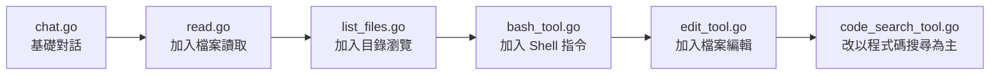
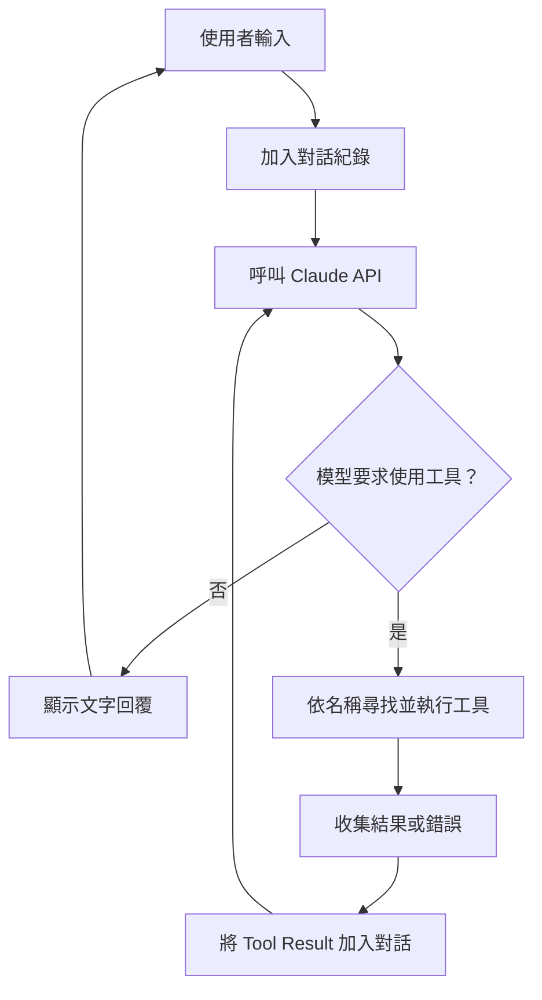

# 從零打造自己的 Coding Agent：循序漸進實作工作坊

[繁體中文（台灣）](README.zh-TW.md) | [English](README.md)

歡迎參加這個實作工作坊！本教學會帶你從簡單的聊天程式開始，逐步加入**讀取檔案、列出目錄、執行終端機指令、編輯程式碼及搜尋程式碼**等工具，親手打造使用 Anthropic Claude API 的 AI 程式開發助理（Coding Agent）。

不需要先具備 AI 專業知識，只要有基本的 Go 程式設計與終端機操作經驗，就能依照六個階段逐步學習。

想先了解整體概念？請閱讀 Geoffrey Huntley 的原始文章：[ghuntley.com/agent](https://ghuntley.com/agent/)。

> **翻譯與原始碼說明：** 本文件是 [英文 README](README.md) 的繁體中文版。程式檔名、API、工具名稱及可執行指令維持原樣，避免和原始碼不一致；下方另補充實際程式結構與 Windows 執行注意事項。

---

## 你將學會什麼？

完成工作坊後，你應能：

- 連接 Anthropic Claude API，建立基礎聊天程式。
- 定義工具（Tool）及其輸入 Schema，讓模型能要求程式執行操作。
- 讓 Agent 讀取檔案、瀏覽目錄、執行 Shell 指令及修改程式碼。
- 處理工具呼叫的結果與錯誤，並回傳給模型繼續推論。
- 使用 `ripgrep` 搜尋程式碼，理解如何擴充自己的 Coding Agent。

## 實作目標：六個版本

每個 Go 檔案都是**可單獨執行的示範程式**，代表一個學習階段：

| 階段 | 程式檔案 | 學習主題 | 提供的工具 |
| --- | --- | --- | --- |
| 1 | `chat.go` | 基礎聊天 | 無 |
| 2 | `read.go` | 讀取檔案 | `read_file` |
| 3 | `list_files.go` | 瀏覽目錄 | `read_file`、`list_files` |
| 4 | `bash_tool.go` | 執行 Shell 指令 | `read_file`、`list_files`、`bash` |
| 5 | `edit_tool.go` | 編輯及建立檔案 | `read_file`、`list_files`、`bash`、`edit_file` |
| 6 | `code_search_tool.go` | 使用 ripgrep 搜尋程式碼 | `read_file`、`list_files`、`bash`、`code_search` |

**注意：** 第六階段示範的是將搜尋工具加入 Agent，並沒有同時註冊第五階段的 `edit_file`；因此不是所有工具都自動累加到最後一個版本。



---

## Agent 的運作原理

所有具備工具的版本，都遵循相似的 **Agent Loop（代理執行迴圈）**：

1. 從終端機接收使用者輸入。
2. 將對話紀錄與可使用的工具定義送往 Claude。
3. Claude 直接回覆文字，或提出一個／多個工具呼叫。
4. 程式依工具名稱找到對應的 Go 函式並執行。
5. 將執行結果或錯誤訊息包成 Tool Result，送回 Claude。
6. 如果 Claude 再次要求使用工具，就繼續執行；否則顯示回覆並等待下一個使用者輸入。



可以將程式架構理解為四個部分：

| 元件 | 職責 |
| --- | --- |
| `Agent` | 維護對話紀錄，控制整個執行迴圈 |
| Anthropic Client | 呼叫 Claude API |
| `ToolDefinition` | 描述工具名稱、用途、輸入 Schema 與實際執行函式 |
| `getUserMessage` | 從標準輸入讀取使用者訊息 |

開啟 `--verbose` 可觀察 API 呼叫、工具執行與錯誤，適合用來理解整個循環。

---

## 開始之前

### 系統需求

- **Go 1.24.2 或更新版本**；也可以使用 [devenv](https://devenv.sh/) 提供的開發環境。
- 一組 [Anthropic API Key](https://platform.claude.com/settings/keys)。
- 第六階段需要 [ripgrep（`rg`）](https://github.com/BurntSushi/ripgrep)。
- 第四階段起會呼叫 `bash`；部分版本也使用 `find`。請確認環境中有這些工具。
- 若要執行產生的 JavaScript 範例，需要安裝 Node.js。

> 使用 Anthropic API 可能產生費用，與 Claude 網頁版訂閱額度不是同一回事。請依自己的 API 帳務設定操作。

### 方式一：使用 devenv（原專案建議）

安裝 devenv 並進入儲存庫資料夾後，執行：

```bash
devenv shell
```

devenv 的設定會準備 Go、ripgrep 與其他開發工具。

### 方式二：手動安裝

先確認 Go 可正常使用，然後在專案目錄執行：

```bash
go version
go mod tidy
```

執行含有 `bash` 或 `code_search` 工具的版本時，也要讓相應的外部指令可從 `PATH` 找到。

### 設定 API Key

**Linux / macOS / Bash：**

```bash
export ANTHROPIC_API_KEY="your-api-key-here"
```

**Windows PowerShell：**

```powershell
$env:ANTHROPIC_API_KEY = "your-api-key-here"
```

以上設定僅供目前的終端機工作階段使用。不要把真實 API Key 寫入程式碼或提交至 Git 儲存庫。

**Windows 使用者注意：** `go run chat.go`、`go run read.go` 等程式可先在 PowerShell 嘗試，但 `bash_tool.go`、`edit_tool.go` 及 `code_search_tool.go` 的部分功能依賴 Unix 指令（`bash`、`find`、`rg`）。若遇到缺少指令或行為不相容，建議在 WSL／Linux 環境中進行後續階段。

---

## 六個實作階段

### 1. `chat.go`：最簡單的聊天程式

先確認能透過 API 與 Claude 對話。此階段**尚未提供任何工具**。

```bash
go run chat.go
```

可以試著輸入：「你好，請簡單介紹自己。」

若要觀察詳細紀錄：

```bash
go run chat.go --verbose
```

**重點：** 找出 `anthropic.NewClient()`、`Agent.Run()` 及傳送 `Messages.New()` 請求的位置。

### 2. `read.go`：加入檔案讀取

讓 Claude 能要求程式讀取檔案內容。

```bash
go run read.go
```

可以試著輸入：「請讀取 `riddle.txt`，並解釋謎題。」

**重點：** 觀察 `read_file` 工具定義、輸入 Schema，以及工具結果如何回傳 Claude。

### 3. `list_files.go`：加入目錄瀏覽

讓 Claude 可以列出檔案，再進一步讀取內容。

```bash
go run list_files.go
```

可以試著輸入：「列出目前資料夾內的檔案。」或「`riddle.txt` 寫了什麼？」

**重點：** 了解如何向 Claude 註冊多個工具，以及如何根據模型回傳的工具名稱呼叫不同函式。

### 4. `bash_tool.go`：執行終端機指令

加入 `bash` 工具，讓 Claude 要求程式執行 Shell 指令。

```bash
go run bash_tool.go
```

可以試著輸入：「執行 `git status` 並說明結果。」或「使用 Shell 指令列出目前的 `.go` 檔案。」

**重點：** 找出程式如何透過 `exec.Command("bash", "-c", ...)` 啟動外部程序，並處理輸出與錯誤。

> **安全提醒：** 這是教學用 Agent，`bash` 工具並非安全沙箱，也沒有完整的指令核准／阻擋機制。只在可接受風險的測試資料夾或隔離環境中執行，不要對重要專案或機密資料直接開放權限。

### 5. `edit_tool.go`：建立及修改檔案

加入 `edit_file` 工具後，Claude 能夠建立檔案及修改檔案內容。

```bash
go run edit_tool.go
```

可以試著輸入：「建立一份可用 Node.js 執行的 `fizzbuzz.js`。」或「在測試檔案最上方加入註解。」

**重點：** 研究工具如何描述編輯操作、讀取既有內容與寫回檔案。操作前請先建立備份，避免誤覆蓋。

### 6. `code_search_tool.go`：搜尋程式碼

透過 [ripgrep](https://github.com/BurntSushi/ripgrep) 的 `rg` 指令，搜尋符合文字或正規表示式的程式碼。

```bash
go run code_search_tool.go
```

可以試著輸入：「找出所有 Go 函式定義。」或「搜尋包含 TODO 的註解。」

**重點：** 觀察 `code_search` 的 `pattern`、`path`、`file_type`、`case_sensitive` 等參數，以及程式如何呼叫 `rg`。

---

## 範例檔案與中文提示詞

- `riddle.txt`：讓 Agent 練習讀取文字的謎題檔。
- `AGENT.md`：原始英文開發環境及程式架構說明；另有 [繁體中文版本](AGENT.zh-TW.md)。
- `prompts/`：原始英文練習提示詞，中文對照放在 [`prompts/zh-TW/`](prompts/zh-TW/)。
- `fizzbuzz.js`：英文 README 提到的範例檔案，但目前儲存庫**並未內附**；可在第五階段要求 Agent 產生。

---

## 工具系統的實作細節

工具不是由 Claude 直接執行，而是程式提供一份工具規格，模型決定何時提出工具呼叫，**由本機 Go 程式實際執行**。

每個工具主要包含：

1. **Name（名稱）**：例如 `read_file`。
2. **Description（用途說明）**：告訴模型何時使用。
3. **InputSchema（輸入結構）**：定義模型必須提供哪些參數。
4. **Function（執行函式）**：真正執行操作的 Go 函式。

以下是依原始碼簡化的示意：

```go
var ReadFileDefinition = ToolDefinition{
    Name:        "read_file",
    Description: "Read the contents of a given relative file path.",
    InputSchema: ReadFileInputSchema,
    Function:    ReadFile,
}
```

專案利用 Go 的 `struct` 與 `jsonschema` 產生輸入 Schema，減少手動撰寫 JSON Schema 的工作。

---

## 建議學習路線

| 階段 | 閱讀檔案 | 優先理解 |
| --- | --- | --- |
| 1 | `chat.go` | API 呼叫、訊息紀錄與模型回覆 |
| 2 | `read.go` | Tool Use、Schema 與 Tool Result |
| 3 | `list_files.go` | 多工具註冊與檔案系統操作 |
| 4 | `bash_tool.go` | 子程序、指令輸出及安全風險 |
| 5 | `edit_tool.go` | 建檔、修改與錯誤處理 |
| 6 | `code_search_tool.go` | 搜尋參數、ripgrep 與外部依賴 |

建議每讀完一個檔案就執行對應版本，使用 `--verbose` 對照實際訊息流程，再動手修改或新增一個工具。

## 疑難排解

**API Key 不生效？** 確認目前 Shell 環境變數是否正確；Linux／macOS 可執行 `echo $ANTHROPIC_API_KEY`，PowerShell 可執行 `$env:ANTHROPIC_API_KEY`。不要把查出的金鑰貼到公開討論區。另請確認 Anthropic API 帳戶的額度與帳務狀態。

**Go 編譯失敗？** 先檢查 `go version` 是否為 1.24.2 或以上，再執行 `go mod tidy`。

**工具執行失敗？** 加上 `--verbose` 取得詳細錯誤；檢查檔案路徑、存取權限及 `bash`、`find`、`rg` 是否已安裝。

**Windows 無法呼叫 bash 或 find？** 請使用具有相應工具的 Shell／WSL。PowerShell 本身不會讓程式中呼叫的 `bash` 或 Unix `find` 自動存在。

**找不到 `main.go`？** 這個儲存庫並沒有 `main.go`。請使用本文件列出的 `go run chat.go` 等指令執行各階段。

**環境安裝問題？** 若環境支援 devenv，可使用 `devenv shell` 統一工具版本。

---

## 選用：開發環境工具

原專案的 `devenv.nix` 設定包含 Go、Node.js、Python、Rust、.NET、Git、ripgrep 等工具，並提供：

```bash
devenv shell   # 進入開發環境
devenv test    # 執行環境檢查
hello          # 執行示範問候指令
```

## 完成後可以做什麼？

- 新增自己的工具，例如呼叫內部 API 或讀取其他格式的檔案。
- 讓 Agent 串接多個工具，完成較完整的工作流程。
- 研究跨工作階段的記憶功能。
- 建立 Web UI。
- 將模型呼叫層抽象化，嘗試支援其他 AI 模型。
- 補上工具權限控管、執行確認、檔案操作限制及隔離環境，使教學原型更適合實際專案。

## 結語

透過這六個 Go 範例，你可以理解 Coding Agent 最核心的組成：**模型 API、工具定義、執行迴圈及本機工具執行**。先把這個基本循環跑通，再逐步增加能力，就能開始打造符合自己需求的開發助理。

本繁體中文版保留原始程式碼與英文教學；如需對照，請回到 [英文 README](README.md)。
