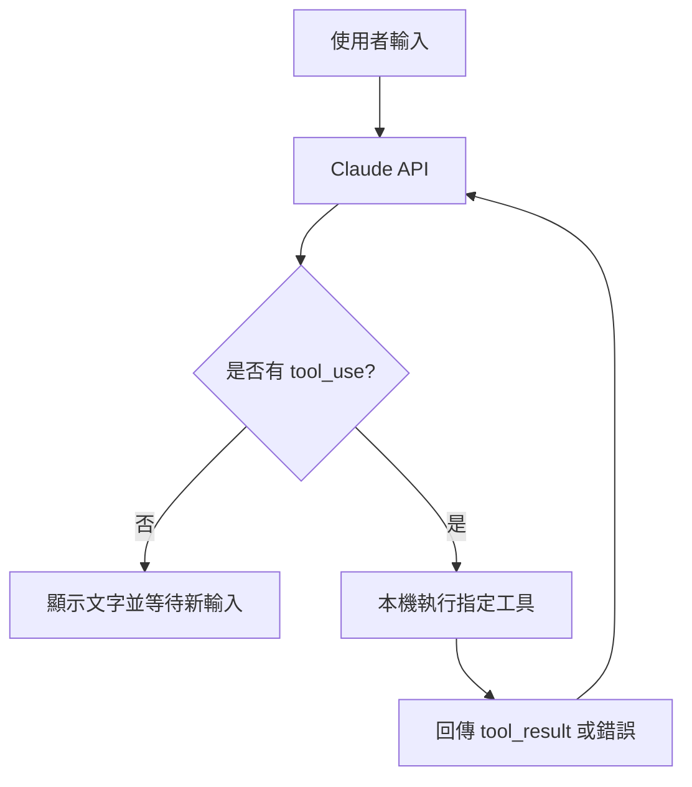

# Coding Agent 六階段程式導讀（繁體中文）

這份導讀延伸 [繁體中文工作坊總覽](../../README.zh-TW.md)，以本專案實際的 Go 原始碼為基礎，說明「為什麼要加這個功能」、「從哪裡讀起」、「如何驗證」與「下一步如何改造」。

**閱讀方式：** 一次選一個 `.go` 範例執行，觀察 `--verbose` 日誌，再完成該章練習。各 `.go` 檔是獨立程式，不要使用 `go run .` 一次編譯整個目錄。

| 階段 | 導讀 | 原始碼 | 增加的能力 |
| --- | --- | --- | --- |
| 1 | [理解聊天與 API](01-chat.md) | [`chat.go`](../../chat.go) | 單純對話 |
| 2 | [第一次 Tool Use](02-read-file.md) | [`read.go`](../../read.go) | 讀取檔案 |
| 3 | [目錄探索](03-list-files.md) | [`list_files.go`](../../list_files.go) | 目錄與檔案列表 |
| 4 | [Shell 指令執行](04-bash.md) | [`bash_tool.go`](../../bash_tool.go) | 執行 Bash |
| 5 | [檔案編輯](05-edit-file.md) | [`edit_tool.go`](../../edit_tool.go) | 建檔、附加與替換文字 |
| 6 | [程式碼搜尋](06-code-search.md) | [`code_search_tool.go`](../../code_search_tool.go) | 使用 ripgrep 搜尋 |

## 共通設定

需要 Go 1.24.2 以上、Anthropic API Key。由於這些範例會呼叫 Anthropic API，**執行可能產生 API 費用**。各階段可以從專案根目錄執行：

```bash
go mod tidy
go run chat.go --verbose
```

Bash／Linux／macOS 設定 Key：

```bash
export ANTHROPIC_API_KEY="your-api-key-here"
```

Windows PowerShell：

```powershell
$env:ANTHROPIC_API_KEY = "your-api-key-here"
```

原始碼中還有額外的外部程式依賴：`bash_tool.go` 需要 `bash`；`code_search_tool.go` 需要 `bash` 與 `rg`（ripgrep）。Windows 建議在 WSL 等有 Unix 指令的環境完成後續實驗。**不要在正式專案或包含機密資料的資料夾直接試跑具有寫入或指令執行能力的 Agent。**

## 核心觀念：模型負責決定，程式負責執行

從第 2 階段開始，模型會收到工具的名稱、說明與輸入 Schema。模型輸出 `tool_use` 後，程式找到對應的 Go 函式、執行工具，並以 `tool_result` 的形式再送回模型。



**關鍵差異：** 模型不是直接取得本機作業系統權限；是開發者所寫的程式授權工具操作。這些示範並未提供完善的權限邊界、沙箱或人工作業核准。

## 實作完成後的檢查表

- [ ] 可以說明 `conversation` 如何保存使用者和 Claude 訊息。
- [ ] 可以解釋 `tool_use`、`tool_result` 與一般文字回答的差異。
- [ ] 可以加入一個新的 `ToolDefinition` 與對應的 JSON Schema。
- [ ] 可以辨識 Shell 指令、檔案路徑及編輯操作的風險。
- [ ] 可以說明為什麼第 6 階段不等於「第 5 階段加上搜尋」。

最後可回到 [繁體中文總覽](../../README.zh-TW.md) 或 [英文原文](../../README.md) 交叉比對；練習題也有 [中文提示詞](../../prompts/zh-TW/README.md)。